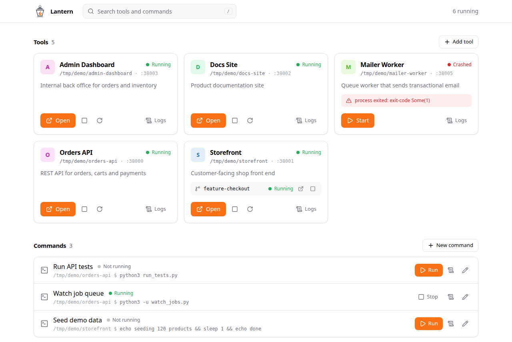
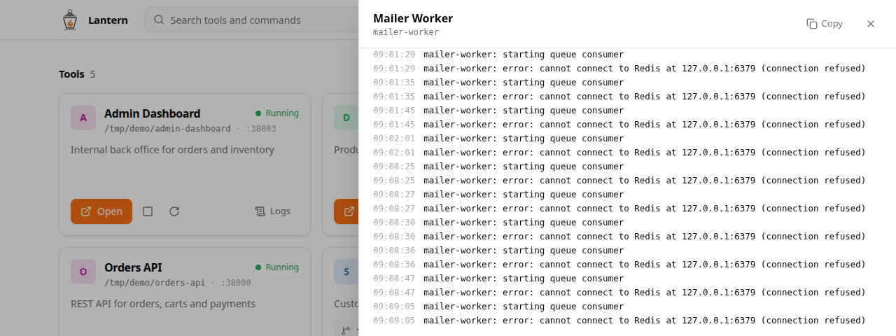
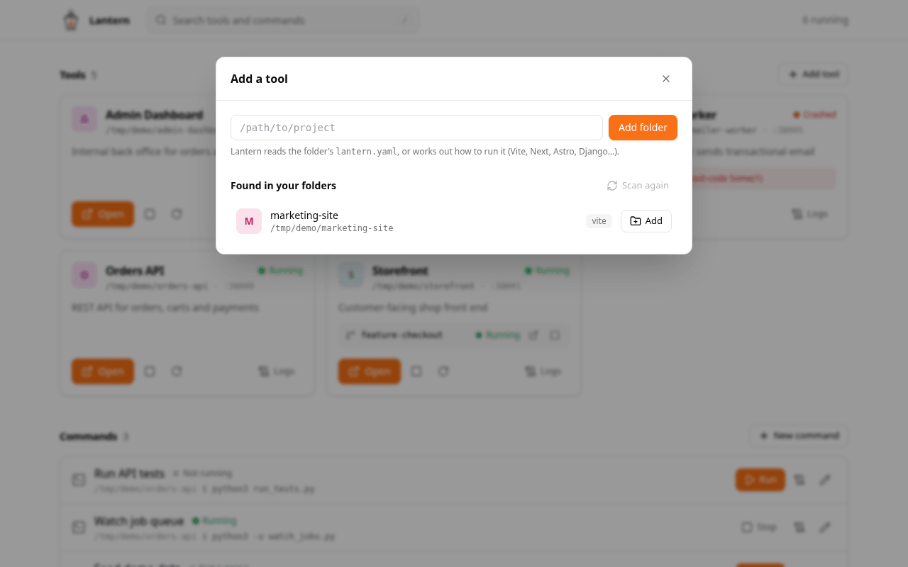
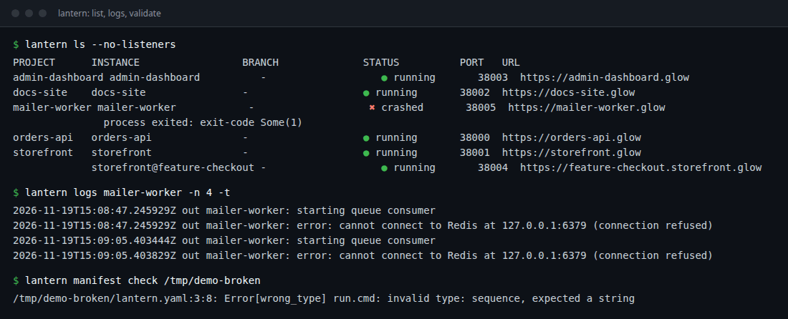
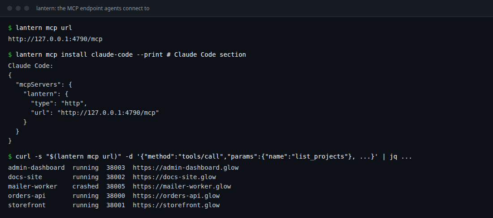
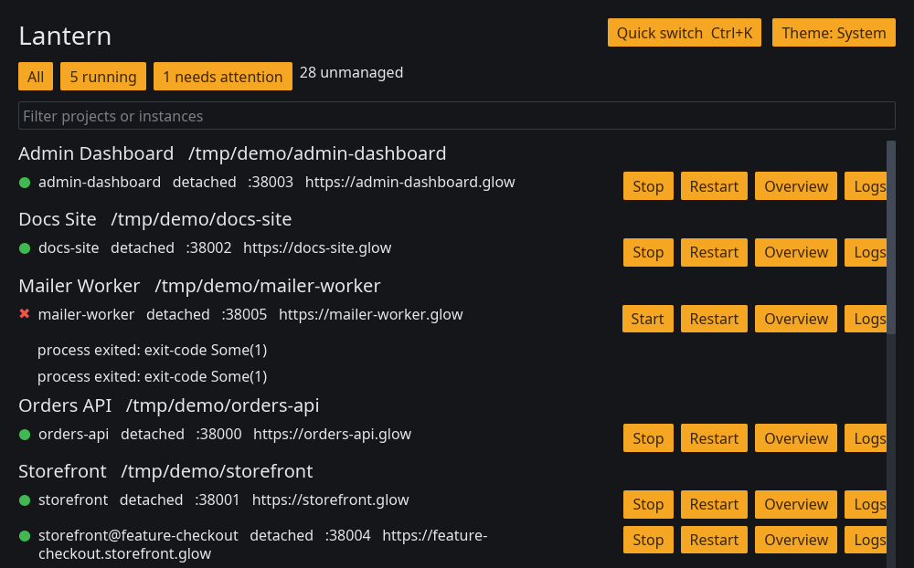

# Lantern: local dev server manager for Linux

**Lantern is a local development server manager and process supervisor for Linux.** Start, stop and watch every dev server on your machine from one control center, a CLI, or an AI agent over MCP. Run any git branch next to `main` with its own port and URL, and see the servers you started by hand too.

<picture>
  <source media="(prefers-color-scheme: dark)" srcset="docs/screenshots/dashboard-dark.png">
  
</picture>

> **Status:** early development (`0.2.0-dev`). Lantern is a Rust rewrite of [Lantern v1](https://github.com/dashw00d/lantern). There are no packaged releases yet; you build it from source (see [Quick start](#quick-start)). The design is written up in [`docs/`](docs/README.md).

## Why Lantern

Local development tends to mean a pile of terminals: a frontend dev server here, an API there, a worker that died an hour ago, and a second copy of the app running on another branch whose port you have forgotten. Coding agents start servers too, and without a shared view they cannot tell what is already running.

Lantern keeps one registry of your projects and runs each dev server as a supervised process:

- one place to see what is running, on which port, and why something failed;
- the same port every time for the same project;
- branches as first-class citizens: run `feature-x` and `main` side by side;
- the same view for humans (web UI, CLI, desktop GUI) and for agents (MCP).

## Features

**Run and supervise dev servers**
- Describe a project in a `lantern.yaml` (command, port variable, health endpoint, environment). Lantern can also detect common setups and ships 13 built-in templates: Django, FastAPI, Flask, Laravel, Next.js, Nuxt, PHP, React Router, Remix, static sites, Symfony and Vite.
- Each server runs as a transient **systemd user unit**, so it keeps running if the Lantern daemon restarts, is stopped as a whole process group, and writes to the user journal.
- Sticky port leases from a configurable range (default 29000-29999), passed to your command as `${PORT}`.
- Readiness and health checks, crash detection with backoff and retries, and a plain-language failure reason on the card and in `lantern ls`.
- Saved **commands** (tests, seed scripts, queue workers) that you can run, stop and read logs for from the control center.

**Branches and worktrees**
- `lantern run myapp@feature-x` reuses or creates a git worktree for the branch, prepares it (copy `.env` files, link folders, run `setup:` commands), and starts it on its own port and name.
- Monorepos are supported: a project can live in a subdirectory of a repo.

**See everything that is listening**
- Lantern reads the kernel's listening sockets, maps each one to a process and working directory, and matches it to a project and branch. A `pnpm dev` you started by hand shows up as an *external* instance.

**Built for AI agents (MCP)**
- A built-in [MCP](https://modelcontextprotocol.io) server at `/mcp` (stateless streamable HTTP) with 22 tools: `list_projects`, `start_project`, `stop_project`, `restart_project`, `get_project_logs`, `list_instances`, `start_branch`, `list_listeners`, `setup_project`, `call_tool_api` and more.
- `lantern mcp install` prints or writes the config for Claude Code, Codex and Cursor.
- Agents can read a project's docs and API endpoints (including OpenAPI) through the same server.

**Clients**
- A web **control center** served by the daemon (React, embedded in the binary).
- A full-featured **CLI** with `--json` output, shell completions and an NDJSON event stream.
- A native **GUI** (`lantern gui`) with a tray icon, and a Tauri 2 desktop window in [`desktop/`](desktop/).

**Optional named HTTPS URLs**
- With Caddy and a one-time `lantern init`, projects also get `https://<name>.glow` URLs (and `https://<branch>.<name>.glow` for branches) from a local, name-constrained certificate authority. See [Named HTTPS URLs](#named-https-urls-optional).

## Screenshots

### Logs and failure reasons



### Add a project



### The `lantern` CLI



### MCP for AI agents



### Native GUI



*All screenshots are real captures of a Lantern daemon running generic demo projects; see [`scripts/screenshots/`](scripts/screenshots/) to regenerate them.*

## Quick start

Lantern is built from source and runs on Linux with a systemd user session.

```bash
git clone https://github.com/dashw00d/lantern2.git
cd lantern2

# 1. Build the web control center (embedded into the binary)
(cd ui && npm ci && npm run build)

# 2. Build the lantern binary
cargo build --release -p lantern
export PATH="$PWD/target/release:$PATH"

# 3. Run the daemon (leave it running); control center at http://127.0.0.1:4777
lantern daemon
```

In another terminal, describe a project and start it:

```bash
cd ~/code/my-app
cat > lantern.yaml <<'EOF'
id: my-app
name: My App
run:
  cmd: npx vite --host 127.0.0.1 --port ${PORT} --strictPort
health_endpoint: /
EOF

lantern add .          # register this directory
lantern on my-app      # start it
lantern ls             # status, port, URL
lantern logs -f my-app # follow the logs
lantern off my-app     # stop it
```

Open <http://127.0.0.1:4777> for the control center. Without named HTTPS set up, reach each app on its own port: the control center's **Open** button goes there, and `lantern ls` shows the port (for example `http://127.0.0.1:29000`). `lantern open my-app` opens the named `https://my-app.glow` URL, which only resolves after the setup in [Named HTTPS URLs](#named-https-urls-optional).

Lantern scans the workspace folders listed in `~/.config/lantern/config.toml` (defaults `~/sites` and `~/tools`) for directories that contain a `lantern.yaml`, and suggests folders that look like dev projects.

To keep the daemon running in the background, [`packaging/lantern.service`](packaging/lantern.service) is a systemd user unit for it (it expects the binary at `/usr/bin/lantern`; adjust `ExecStart` if you installed elsewhere).

## Usage

### Everyday commands

```bash
lantern ls                        # instances and unmanaged listeners
lantern ls --no-listeners         # only your projects
lantern on api web                # start several at once
lantern restart api
lantern off --all -y              # stop everything Lantern started
lantern logs -f -t web            # follow logs with timestamps
lantern status                    # daemon health and instance counts
lantern scan ~/code               # register every folder under ~/code that has a lantern.yaml
lantern manifest check            # validate lantern.yaml (line:column errors)
lantern schema manifest           # JSON Schema for editor autocompletion
lantern --json ls                 # machine-readable output (works on every command)
```

### Run any branch

```bash
lantern run my-app@feature-x            # reuse or create a worktree for feature-x and start it
lantern run my-app@new-idea --new --base main   # create a new branch from main
lantern run my-app --pr 123             # check out a pull request
lantern wt ls my-app                    # list checkouts
lantern wt rm my-app@feature-x          # remove a managed worktree (refuses if there is unsaved work)
```

Add `setup:` and `worktree:` keys to `lantern.yaml` to control how a new checkout is prepared:

```yaml
setup:
  - pnpm install --frozen-lockfile
worktree:
  copy: [".env", ".env.local"]
```

### A `lantern.yaml` example

```yaml
id: orders-api
name: Orders API
description: REST API for orders, carts and payments
tags: [api, backend]
run:
  cmd: python3 -u serve.py --port ${PORT}
  env:
    APP_ENV: development
health_endpoint: /health
```

The full key reference is in [`docs/14-config.md`](docs/14-config.md) and the JSON Schema is in [`schema/`](schema/). Unknown keys only warn, and mistakes are reported with a line and column.

### Use Lantern with Claude Code, Codex and Cursor (MCP)

With the daemon running:

```bash
lantern mcp url                      # http://127.0.0.1:4777/mcp
lantern mcp install claude-code --print   # show the config without writing anything
lantern mcp install claude-code      # write it (also: codex, cursor, json)
```

Your agent can then list projects, start and stop servers, read logs, start a branch and check which ports are in use, instead of guessing. `call_tool_api` only reaches projects registered with Lantern.

### Named HTTPS URLs (optional)

The design gives each project a URL like `https://my-app.glow` using three pieces: Caddy (2.8 or newer) as the reverse proxy, a Lantern-generated certificate authority that can only sign `.glow` names, and a small DNS responder in the daemon that systemd-resolved delegates `.glow` lookups to. Setup is one command, which asks for your password once through polkit:

```bash
lantern doctor        # what is and is not configured
lantern init          # one-time system steps (privileged ports, DNS delegate, CA trust)
```

Details and the security reasoning are in [`docs/13-system.md`](docs/13-system.md). This part needs system changes and a Caddy binary, so it is not part of the quick start above.

## How it works

```
 lantern CLI ─┐                     ┌─ systemd --user transient units (lantern-inst-<project>)
 control      ├─►  lantern daemon ──┤   one per running instance; logs go to the user journal
 center / GUI │    127.0.0.1:4777   ├─ Caddy (optional): HTTPS names, local CA
 AI agents  ──┘    REST + SSE + MCP └─ DNS responder for *.glow (optional)
```

- One binary, `lantern`, is the daemon, the CLI and the GUI. The CLI, GUI and control center are plain HTTP clients of the daemon; they never start processes themselves.
- The daemon binds to loopback only and rejects requests with an unexpected `Host` or `Origin` header.
- Dev servers belong to systemd, not to the daemon, so restarting or upgrading Lantern does not stop them.
- State is a registry in `~/.local/state/lantern/state.json`; your preferences are in `~/.config/lantern/config.toml`; each project's behavior lives in its own `lantern.yaml`.

The Rust workspace is split into `lantern-core` (types, manifest, settings), `lantern-system` (init and doctor), `lantern-daemon` (registry, runtime, discovery, git, API and MCP), `lantern-client`, `lantern-cli` and `lantern-gui`, with the `lantern` crate as the entry point. Start with [`docs/01-architecture.md`](docs/01-architecture.md); the rest of the design docs are indexed in [`docs/README.md`](docs/README.md).

## Requirements

- Linux with a systemd user session (the design targets Ubuntu 26.04 with systemd 259). The DNS delegate for named URLs needs systemd 258 or newer.
- Rust 1.99 or newer (edition 2024) to build.
- Node.js and npm to build the web control center (`ui/`).
- `git` for branch and worktree features.
- Optional: Caddy 2.8 or newer for `https://<name>.glow` URLs.
- Optional: WebKitGTK to build the Tauri desktop window in [`desktop/`](desktop/), which is a separate crate so the main build does not need it.

## Development

```bash
cargo test --workspace                  # unit and in-process tests
cargo clippy --workspace --all-targets -- -D warnings
scripts/check.sh                        # fmt, clippy and tests; add --ignored for real-system tests
cd ui && npm run dev                    # control center with hot reload
```

`lantern daemon --dev` runs a development daemon on port 4778 with the `glow2` domain and its own config and state directories, so it can run next to another Lantern. To migrate from v1, `lantern migrate-v1 --dry-run` shows what would be imported.

## Regenerating the screenshots

The images in `docs/screenshots/` are produced by [`scripts/screenshots/`](scripts/screenshots/): `demo.sh` starts an isolated daemon (own ports, config and `HOME` under `/tmp`) seeded with generic demo projects, `capture.mjs` takes the web and terminal screenshots with headless Chromium, and `gui.sh` captures the native GUI under Xvfb.
